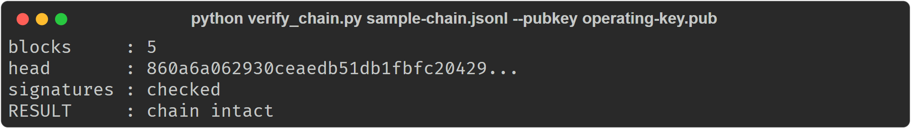
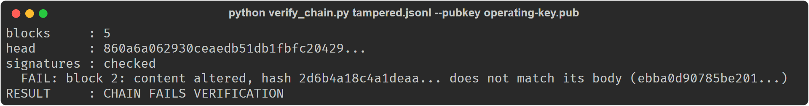
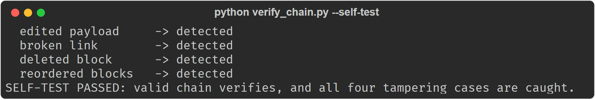

# chain-verify

A stranger's kit for checking a Saluca tamper-evident hash chain: the format, a signed sample, the public key, and a verifier that imports none of Saluca's code.

> **Correction, 2026-10-22.** Two statements here and in `CHAIN-FORMAT.md` said more than the
> verifier checks. What they said, and what is true:
>
> 1. *"It proves ... each signature was made by the holder of the key in block 0."* The verifier
>    checks signatures against the key file you pass with `--pubkey`. It never reads the
>    `operating_pubkey` recorded in block 0, so a chain whose genesis names one key but which was
>    signed with another passes if you supply the signing key (tested). For this sample the two
>    keys are the same (also tested), but you have to compare them yourself; see
>    [Usage](#usage).
> 2. *"A deleted block breaks rule 1 and rule 2"* (`CHAIN-FORMAT.md`). True for any block except
>    the last ones: deleting blocks from the **end** of the chain leaves every remaining seq, link,
>    hash and signature valid, and the result is `chain intact` (tested by dropping block 4). A
>    chain does not record its own length, so truncation is only detectable against a head hash
>    you recorded earlier, out of band.

## Status

Research artifact, maintained. What works today: the verifier checks seq order, links, SHA-512 body
hashes and (with `--pubkey` and `cryptography` installed) Ed25519 signatures, and its `--self-test`
shows it catching an edited payload, a broken link, a deleted middle block and a swapped pair. CI
runs the self-test, verifies the sample, and requires a tampered copy to be rejected. What it does
not do: compare `--pubkey` with the key in block 0, or detect truncation of the tail (see the
correction above).

Saluca says its agents keep a hash-chained record, so corruption is detectable rather than silent.
That is a claim about a data structure, and a claim about a data structure is one a stranger can
check. This repository is the stranger's copy: a sample chain, the public key it was signed with,
the format written out in full, and a verifier that imports none of our code.

## Install

Tested 2026-10-22 with Python 3.12.10 and `cryptography` 50.0.2.

```bash
git clone https://github.com/saluca-labs/chain-verify
cd chain-verify
pip install cryptography      # optional: needed for the signature check only
```

The verifier itself is one file and uses the standard library. `cryptography` is needed for the
signature check. Without it the hashes are still checked and the output says, in those words, that
signatures were not.

## Quickstart

```
python verify_chain.py sample-chain.jsonl --pubkey operating-key.pub
```

```
blocks     : 5
head       : 860a6a062930ceaedb51db1fbfc20429...
signatures : checked
RESULT     : chain intact
```

Now break it. Change one number in one payload, say `"bytes": 412` to `"bytes": 999999`, and run it
again:

```
blocks     : 5
head       : 860a6a062930ceaedb51db1fbfc20429...
signatures : checked
  FAIL: block 2: content altered, hash 2d6b4a18c4a1deaa... does not match its body (ebba0d90785be201...)
RESULT     : CHAIN FAILS VERIFICATION
```

Exit code 2. That is the whole point of the structure, and it took one edit to demonstrate.
(Both outputs re-run from a clean clone on 2026-10-22.)

## Usage

### Prove the verifier can fail before you trust it

```
python verify_chain.py --self-test
```

It builds a valid chain, then breaks it four ways: an edited payload, a broken link, a deleted
block, and two blocks swapped. If any of them verified, the self-test fails and says so. A checker
that has never been seen to fail is not evidence of anything. The deleted block in the self-test is
a middle block; deleting the last block is not detected (see the correction above).

```
  edited payload     -> detected
  broken link        -> detected
  deleted block      -> detected
  reordered blocks   -> detected
SELF-TEST PASSED: valid chain verifies, and all four tampering cases are caught.
```

### Check that the key you were given is the key in block 0

`verify_chain.py` does not do this for you. With `cryptography` installed:

```bash
python -c "import json; from cryptography.hazmat.primitives import serialization as s; k=s.load_pem_public_key(open('operating-key.pub','rb').read()).public_bytes(s.Encoding.Raw,s.PublicFormat.Raw).hex(); g=json.loads(open('sample-chain.jsonl').readline())['payload']['operating_pubkey']; print('match' if k==g else 'MISMATCH')"
```

For the published sample this prints `match`.

### Exit codes

`0` the chain verified, `2` it failed verification (a command-line usage error also exits `2`),
`1` the self-test failed. Without `--pubkey`
(or without `cryptography`) the result line can still say `chain intact`; read the `signatures`
line before treating that as a signature check.

## What a pass proves, and what it does not

**It proves** this file is internally consistent: every block hashes to its stated hash, every link
points at its predecessor, and each signature was made by the holder of the key you passed with
`--pubkey`.

**It does not prove** that the events described ever happened, or that any particular system
produced them. A hash chain shows a record has not been altered since it was written. It cannot
show the record was true when written. We would rather say that here than have you discover it.
It also does not show that blocks were not removed from the end.

**The sample is a demonstration, not an export.** The events in it are invented, and the key was
generated for this file and then discarded. What is real is the code path: the chain was produced
by the same implementation that runs in the product, not by a script written to make this sample
verify. That implementation is not open source; the format is, which is why `verify_chain.py` is
written from [CHAIN-FORMAT.md](CHAIN-FORMAT.md) and shares nothing with it.

If you want the stronger version of this artifact, a signed export from a live system with a
published key, say so. It is a reasonable thing to ask for and we do not have it published yet.

## Architecture

| File | What it is |
|---|---|
| `verify_chain.py` | the verifier, standard library plus optional `cryptography`, about 160 lines |
| `CHAIN-FORMAT.md` | the format, in enough detail to write your own verifier and disagree with ours |
| `sample-chain.jsonl` | five blocks, produced by the production implementation |
| `operating-key.pub` | the Ed25519 public key, PEM |
| `.github/workflows/verify.yml` | CI: self-test, sample verifies, tampered copy is rejected |

Each line of the chain is one JSON block. The hash is SHA-512 over the canonical JSON of
`{seq, ts, kind, payload, prev_hash}` followed by one 0x1E byte; the signature is Ed25519 over the
ASCII hash. `CHAIN-FORMAT.md` has the details a re-implementation gets wrong.

## Screenshots

Captured 2026-10-22 from a clean clone of `verify-artifact`; the command and the verbatim text are in
the `.txt` file beside each image.







## Citation

No archived record yet.

## License

Apache-2.0 (SPDX: `Apache-2.0`, see [`LICENSE`](LICENSE)), so a verifier anyone is invited to
reimplement can also be reused.

## Links

- [CHAIN-FORMAT.md](CHAIN-FORMAT.md): the format
- [draft-ruvalcaba-hctp](https://datatracker.ietf.org/doc/draft-ruvalcaba-hctp/): Saluca LLC's Internet-Draft for the Hash-Chain Context Transfer Protocol, the source of the `hctp-genesis-v1` marker
- [saluca-labs/soulguard](https://github.com/saluca-labs/soulguard): Saluca's open library for tamper-evident agent memory (a different, SHA-256 chain format)

## Why this exists

Asked on 2026-09-16 what would make the claim "our agents keep a tamper-evident record" checkable
by someone who does not trust us, the honest answer was: publish the format, publish a signed
sample, and publish a verifier that does not share our code. So here it is.

_Last updated: 2026-10-22_
